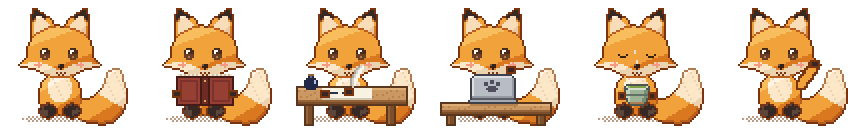

# fox

Claude とその分身（サブエージェント）が働く様子を，ドット絵のキツネでパネルに映す．待ち時間を楽しく過ごすためのもの．

## 導入

手順はマーケットプレイスの README（リポジトリ最上位の README.md）が定める．

- **対応先**：Claude Code 専用．パネルは Claude Code の画面拡張（mod）で，チャットでは働かないので，Claude には追加できないようにしてある．
- **依存先**：theater

theater は，絵をパネルに映す仕組みを持つプラグインで，fox を導入すれば併せて入る．

## 使い方

- **パネル**：VS Code・デスクトップアプリ・モバイルの Claude Code では，自動で開く（クラウドで動かすセッションのパネルは，モバイルでは出ない）．端末の Claude Code では自動で開かず，`/fox` で開くと，絵の代わりに役割（調べる・書く・実行する等）が文字で並ぶ．閉じたパネルも `/fox` で開き直す．
- **ほかのキャラクター**：theater に絵を持ち寄るキャラクターをほかにも導入しているなら，パネルに映るのは，最後にコマンド（キツネなら `/fox`）で選んだキャラクターである．一度も選んでいないか，選んだキャラクターが導入されていなければ，最初に読み込まれたキャラクターが映る．
- **眠気**：会話が長くなってコンテキストの量が増えるほど，Claude 自身のキツネは眠そうになる．会話を圧縮して量が減れば，目覚める．
- **一言**：キツネの絵の下には，受けている指示を表す一言が出る．Claude 自身の一言は，依頼（スラッシュコマンドを除く）を送るたびに，小さなモデルを1回呼び出して付ける．付けられなかったときは，依頼の文をそのまま出す．分身の一言は，起動のときに付いた仕事の名前（無ければエージェントの種類）で，追加の指示が届けば，その要約に替わる．
- **数が多いとき**：VS Code が一度に描ける絵の量と，同時に動かせる絵の数（6枚）には限りがある．VS Code では，キツネが7体以上になると，仕事を終えて眠っている分身のキツネから先に，絵が止まる．絵の量が収まらないときは，絵の入らないキツネが一言ごと省かれ，パネルの下に，省いた数の断りが出る．絵が出るのは，まだ働いているキツネが先である．絵が小さくなったり，別の絵に代わったりすることは無い．デスクトップアプリとモバイルでは，どのキツネも，そのままの絵で映る．
- **重いとき**：PC の処理が重いと，VS Code がキツネを止めたり，絵の代わりに役割の文字を出したりする．しばらくすると元に戻る．
- **費用**：パネルを開いていなくても，一言を付ける呼び出しは走る．その費用はセッションに計上される．

## 開発

キツネの絵の決まり，確かめ方，絵の書き出しの手順は [DESIGN.md](DESIGN.md) が定める．絵を画面へ出す仕組みは theater が持つ．
